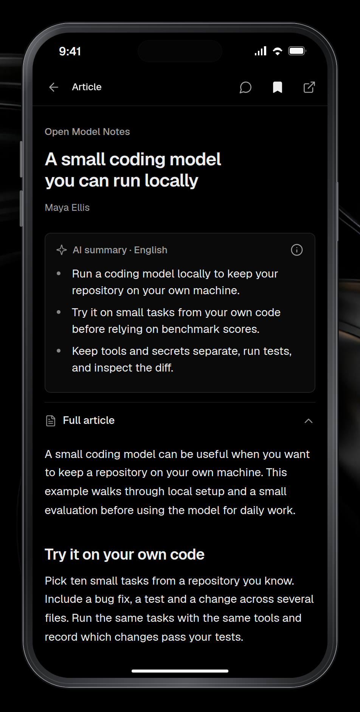
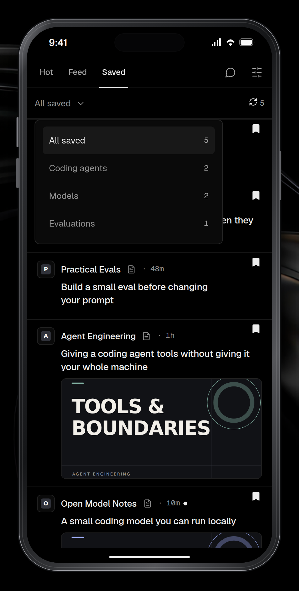
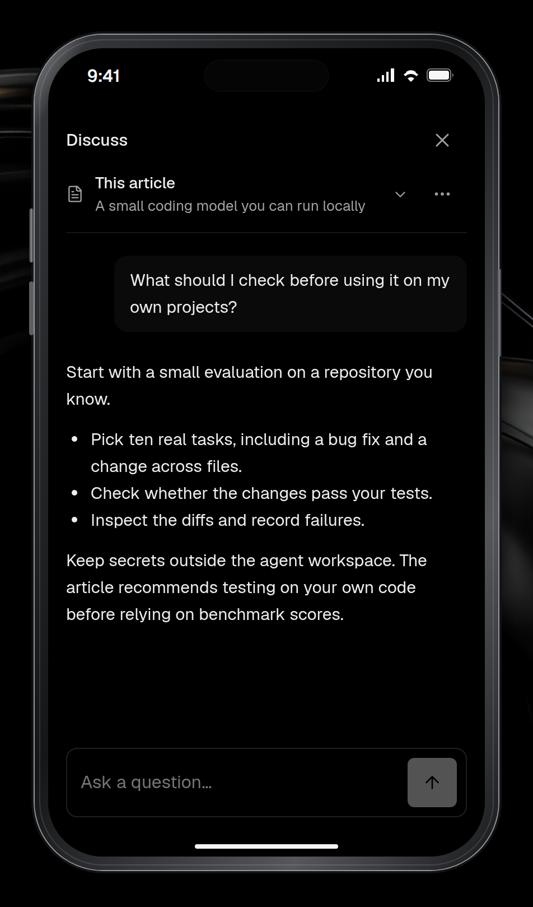

# Stillfeed

A personal AI news feed for your phone.

Stillfeed collects posts from X, YouTube channels, RSS feeds and Reddit into one feed you can scroll like
Twitter. It checks your sources on a schedule. With an AI provider connected, it picks posts based on your
interests and prepares short summaries of articles and videos with available transcripts.

Open it a few times a day, read what looks useful, and save what you want to keep. When you're done,
Hide seen clears the posts you've reviewed. Your bookmarks stay saved.

You run Stillfeed on your own server and open it in a browser, or add it to your phone's home screen as a PWA.


[Quick start](#quick-start) · [Configuration](docs/configuration.md) · [Development](docs/development.md) · [MIT license](LICENSE)

## A quick look

The screenshots below use example content in the actual app.

### Your sources in one feed

Read posts, articles and videos together. Follow X accounts, add RSS feeds and YouTube channels, or subscribe
to a subreddit's feed. Refresh runs every two hours by default; you can change the schedule in settings.


### Hot picks for your interests

Describe what you care about. Hot selects matching posts from your current feed and gives a short reason
for each pick. It shares the same read and hidden state as Feed.


### A summary before the full article

Open an article for a three-point summary and clean text. Videos with available transcripts can be read and
summarized too. Choose the summary language in your configuration.



### Save things you want to come back to

Bookmark articles and posts as you browse. Saved groups them by topic automatically. Reading an item or
hiding it from Feed does not remove its bookmark.



### Ask about what you're reading

Open Discuss to ask a follow-up question about an article or the current batch. The conversation stays in
Stillfeed, alongside the content you're reading.



### Clear the posts you've seen when you're ready

The counter shows seen items out of the current batch. Tap it and choose Hide seen to clear those posts,
with Undo if you change your mind. Opening or scrolling past an item never removes it by itself.


## Quick start

You need [Bun](https://bun.sh) 1.4 or newer.

```sh
git clone https://github.com/fyrr-ai/stillfeed && cd stillfeed
bun install --frozen-lockfile
cp .env.example .env    # optional: choose an AI provider and summary language
bun start               # open http://127.0.0.1:3200
```

The first collection starts on its own. Add an AI provider to enable summaries, Hot, topic grouping and
chat. Stillfeed supports Anthropic, OpenAI-compatible APIs, local models through compatible endpoints, and
the Codex CLI. Collection and reading still work without AI.

X uses an optional paid [SocialData](https://socialdata.tools) API connection. Other sources work without it.
Setup, provider options and refresh settings are in [Configuration](docs/configuration.md).

Stillfeed has no login. Reach it from your phone through Tailscale, an SSH tunnel or your own reverse proxy.
Docker instructions are in [Configuration](docs/configuration.md#running-it).

## Documentation

- [Configuration](docs/configuration.md) covers sources, AI providers, summaries, interests, chat and deployment.
- [Development](docs/development.md) covers the code, tests, build and screenshot generator.
- [Contributing](CONTRIBUTING.md) covers changes and translations.

## License

[MIT](LICENSE). The web collectors and keyword filter started as a port of
[LearnPrompt/ai-news-radar](https://github.com/LearnPrompt/ai-news-radar). Third-party notices are in [NOTICE](NOTICE).
