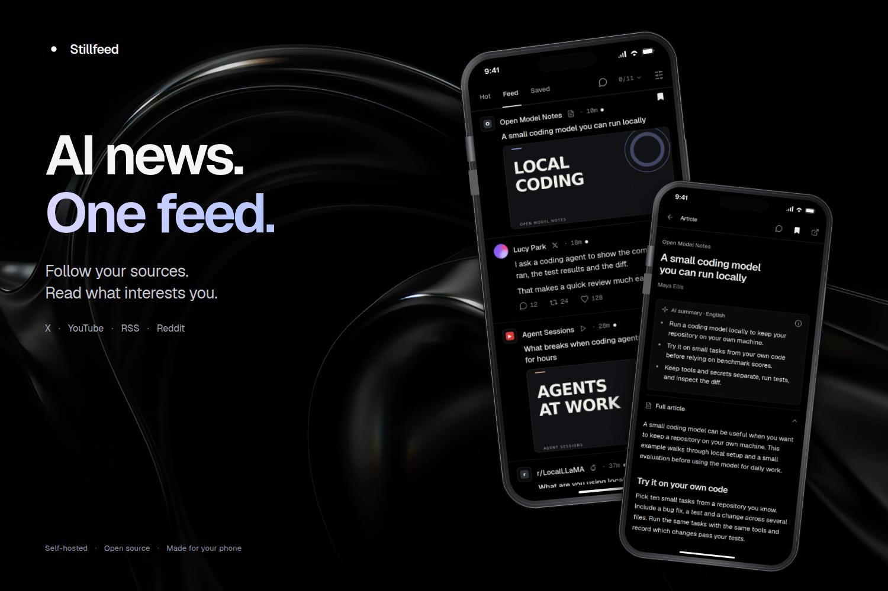
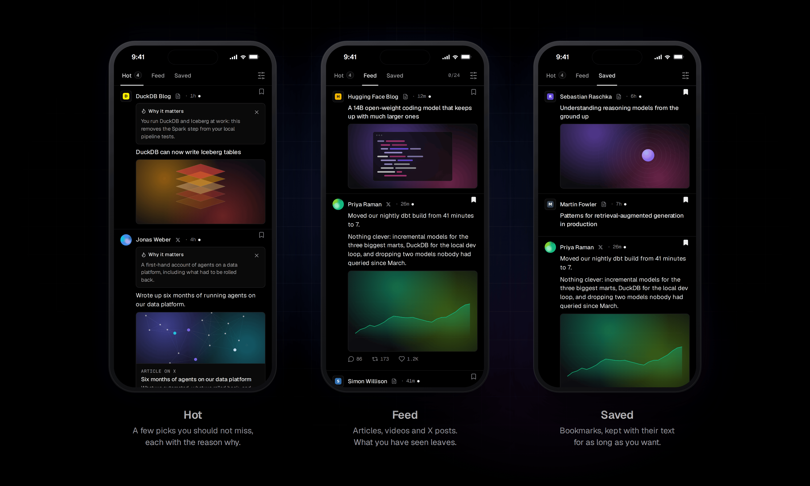
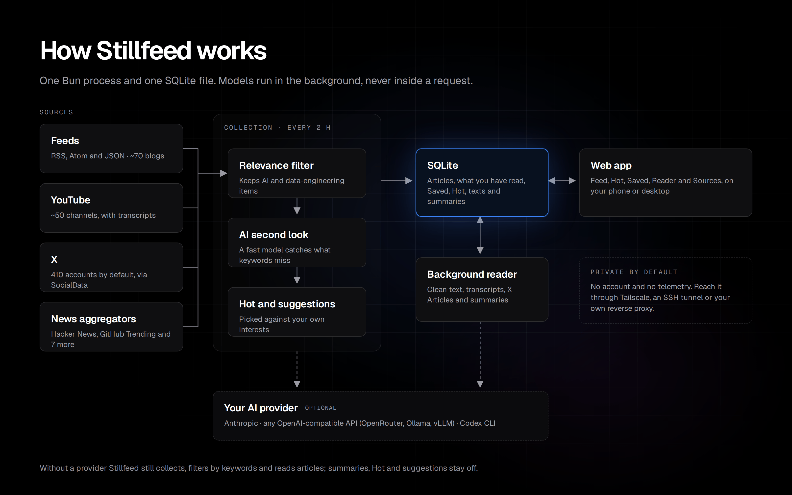

# Stillfeed

**Keep up with AI and data engineering in ten minutes a day: one private feed instead of fifty tabs.**



<p align="center">
  <a href="https://github.com/fyrr-ai/stillfeed/actions/workflows/ci.yml"></a>
  <a href="LICENSE"></a>
  <a href="https://bun.sh"></a>
  <a href="docs/configuration.md"></a>
</p>

**What it is:** a news reader you host yourself. It has two parts, and one command starts both:

- **A small server** (on your laptop, a home server or any VPS). Every two hours it fetches the blogs,
  YouTube channels, news sites and X accounts you follow, keeps what is about AI and data engineering,
  and prepares clean text and AI summaries in the background.
- **A web app** it serves, made for the phone first. Open it in any browser, or add it to your home screen,
  where it behaves like an app. There is nothing to install from an app store, and no account or cloud
  service: the server and its single SQLite file are yours.

In the app you scroll one timeline instead of fifty tabs, see the few things you should not miss today,
and read any article, video or X post as clean text with a short summary in your language.

[Quick start](#quick-start) · [Configuration](docs/configuration.md) · [How it works](#how-it-works) · [Development](docs/development.md)

## Why Stillfeed

- **Save time.** About 70 blogs, 50 YouTube channels, 9 news aggregators and 410 X accounts arrive in one
  feed. What you have seen leaves, so every visit shows only what is new.
- **Never miss what matters.** Hot picks a handful of items each day against your own description of your
  interests, and tells you why each one matters to you.
- **Read less, understand more.** Articles, video transcripts and X Articles open as clean text with a
  three-point AI summary in the language you choose.
- **Private and yours.** One process and one SQLite file on your machine. No account, no telemetry. Use
  Anthropic, any OpenAI-compatible API (including local models through Ollama), the Codex CLI, or no AI at all.



It is fast on a phone: the first load is about 110 KB, and the app scores 100 in Lighthouse on desktop.

## How it works

1. **Connect your sources.** Start with the curated defaults, add any feed, website or YouTube channel by
   its address, and follow X accounts by handle.
2. **Stillfeed filters and ranks.** Every two hours it collects new items, keeps those about AI and data
   engineering, and picks Hot against your interests.
3. **Read and get summaries.** Open an item for its clean text and summary. Save what you want to keep.



## Quick start

You need [Bun](https://bun.sh) 1.4 or newer.

```sh
git clone https://github.com/fyrr-ai/stillfeed && cd stillfeed
bun install --frozen-lockfile
cp .env.example .env    # optional: add an AI key and your summary language
bun start               # open http://127.0.0.1:3200
```

The first collection starts on its own. Stillfeed has no login, so reach it from your phone through
Tailscale, an SSH tunnel or your own reverse proxy rather than the open internet. Docker, AI providers,
your interests and sources are covered in [Configuration](docs/configuration.md).

## Documentation

- [Configuration](docs/configuration.md): AI providers, summary language, your interests, sources, X, Docker
  and every setting.
- [Development](docs/development.md): tests, speed budgets, the build and how the pieces fit together.
- [Contributing](CONTRIBUTING.md): ground rules for changes and translations.

## License

[MIT](LICENSE). The web collectors and the keyword filter started as a port of
[LearnPrompt/ai-news-radar](https://github.com/LearnPrompt/ai-news-radar) (MIT). Third-party notices are in
[NOTICE](NOTICE).
