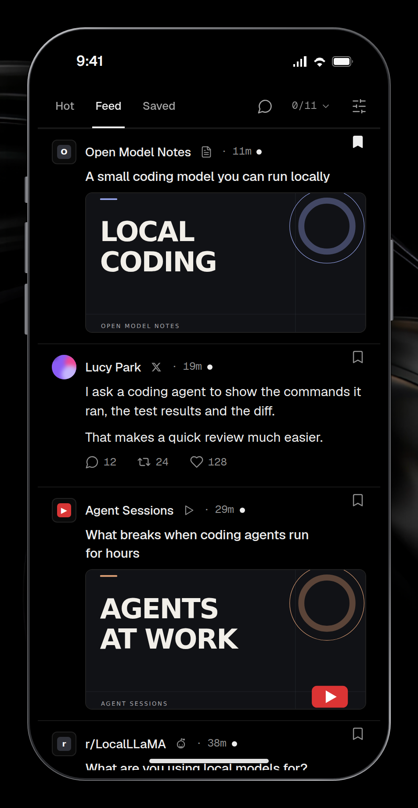
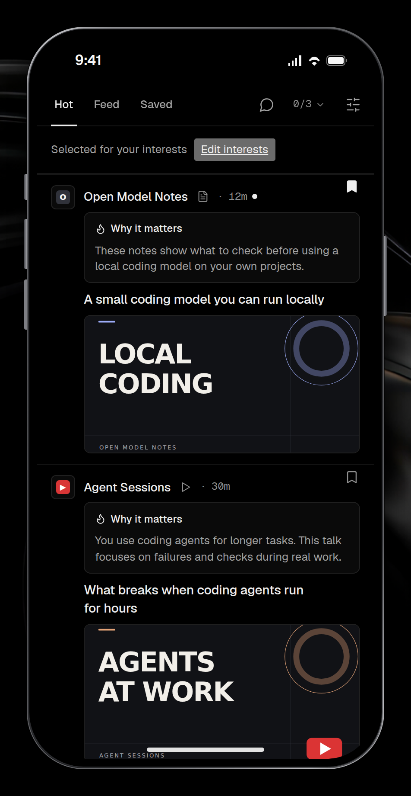
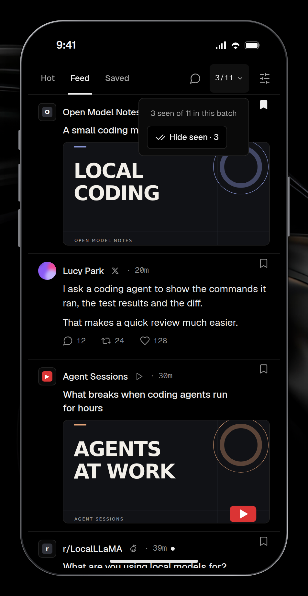

# Stillfeed

**A personal AI news feed for your phone.** Stillfeed collects posts from X, YouTube channels, RSS feeds,
Reddit and selected news sites into one feed. With an AI provider connected, it picks posts for your
interests and summarizes articles and videos in your language.

Open source and self-hosted. Run it on your own server and add it to your phone's home screen as a PWA.

[Quick start](#quick-start) · [Configuration](docs/configuration.md) · [Development](docs/development.md) · [MIT license](LICENSE)

## How it works

Open it a few times a day, read what looks useful, and save what you want to keep. When you're done, Hide
seen clears the posts you've reviewed. Your bookmarks stay saved. The screenshots use example content in
the actual app.

<table>
<tr>
<td width="33%" valign="top">

<h3>Feed</h3>
Posts, articles and videos from all your sources in one list. Refresh runs every two hours by default.
</td>
<td width="33%" valign="top">

<h3>Hot</h3>
Describe what you care about. Hot picks matching posts from your current feed and says why each one fits.
</td>
<td width="33%" valign="top">

<h3>Read</h3>
A three-point summary before the clean article text. Videos with transcripts work too.
</td>
</tr>
<tr>
<td width="33%" valign="top">

<h3>Saved</h3>
Bookmark anything as you browse. Saved groups your bookmarks by topic automatically.
</td>
<td width="33%" valign="top">

<h3>Discuss</h3>
Ask a follow-up question about an article or the current batch, without leaving Stillfeed.
</td>
<td width="33%" valign="top">

<h3>Hide seen</h3>
The counter shows what's left to see. Hide seen clears what you've read, with Undo. Nothing disappears on its own.
</td>
</tr>
</table>

## Quick start

You need [Bun](https://bun.sh) 1.4 or newer.

```sh
git clone https://github.com/fyrr-ai/stillfeed && cd stillfeed
bun install --frozen-lockfile
cp .env.example .env    # optional: choose an AI provider and summary language
bun start               # open http://127.0.0.1:3200
```

The first collection starts on its own. Add an AI provider to enable summaries, Hot, topic grouping and
chat. Stillfeed supports Anthropic, OpenAI-compatible APIs, local models through compatible endpoints, and
the Codex CLI. Collection and reading still work without AI.

X uses an optional paid [SocialData](https://socialdata.tools) API connection. Other sources work without it.
Setup, provider options and refresh settings are in [Configuration](docs/configuration.md).

Stillfeed has no login. Reach it from your phone through Tailscale, an SSH tunnel or your own reverse proxy.
Docker instructions are in [Configuration](docs/configuration.md#running-it).

## Documentation

- [Configuration](docs/configuration.md) covers sources, AI providers, summaries, interests, chat and deployment.
- [Development](docs/development.md) covers the code, tests, build and screenshot generator.
- [Contributing](CONTRIBUTING.md) covers changes and translations.

## License

[MIT](LICENSE). The web collectors and keyword filter started as a port of
[LearnPrompt/ai-news-radar](https://github.com/LearnPrompt/ai-news-radar). Third-party notices are in [NOTICE](NOTICE).
