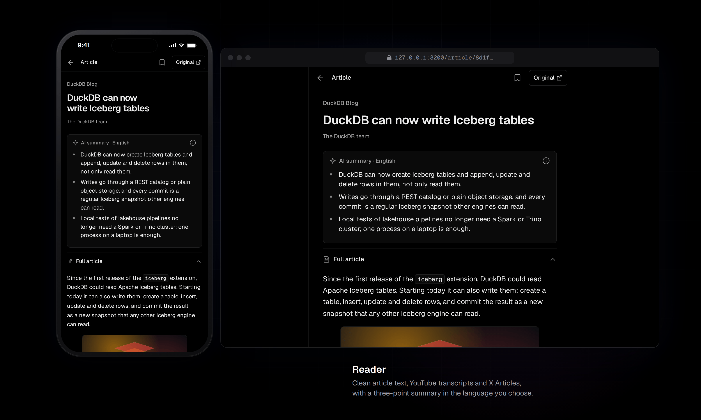
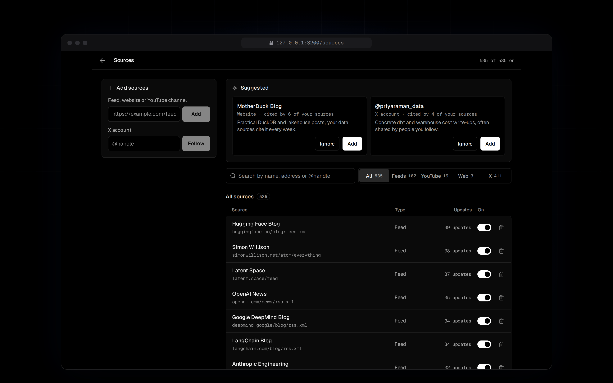

# Configuration

Everything is optional: Stillfeed runs with no settings at all. Settings come from environment variables or a
`.env` file in `STILLFEED_HOME` (default `~/.local/share/stillfeed`) or the working directory. Real environment
variables win. [.env.example](../.env.example) lists every setting with a comment.

## AI provider

Without a provider Stillfeed still collects, filters by keywords and shows clean article text; summaries, Hot
and source suggestions stay off. With one, pick it like this:

| Provider | Set | Default model |
|---|---|---|
| Anthropic | `ANTHROPIC_API_KEY` | `claude-opus-5-5` |
| OpenAI or any OpenAI-compatible server (OpenRouter, Ollama, vLLM, LM Studio) | `OPENAI_API_KEY`, `STILLFEED_LLM_MODEL`, optionally `OPENAI_BASE_URL` | none, set one |
| [Codex CLI](https://github.com/openai/codex) (uses your ChatGPT plan) | `STILLFEED_LLM=codex` | `gpt-6-luna` |

When `STILLFEED_LLM` is unset, Stillfeed uses Anthropic if `ANTHROPIC_API_KEY` is set, else OpenAI if
`OPENAI_API_KEY` is set. `STILLFEED_LLM=none` turns AI off.

`STILLFEED_LLM_MODEL` chooses the model for summaries, Hot and suggestions. `STILLFEED_LLM_FAST_MODEL` chooses
the one that double-checks items the keyword filter would drop; it runs on every refresh, so a small model such
as `claude-haiku-5-5` keeps it cheap. With Anthropic models that support it, Stillfeed opts into the API's
server-side fallback: a request the model declines is retried on a fallback model in the same call.

Models never run inside a web request. The collection and a background reader call them, and the app only
reads their cached results.

## Summary language



`STILLFEED_LANGUAGE` sets the language of summaries, Hot reasons and suggestion reasons, for example `Czech`,
`German` or `Japanese` (default `English`). Summaries are cached per text and language, so changing it writes
new ones. The interface itself is English and ready for translation (`ui/i18n.ts`, see
[CONTRIBUTING.md](../CONTRIBUTING.md#translations)).

## Your interests

Copy [interests.example.md](../interests.example.md) to `~/.local/share/stillfeed/interests.md` (or point
`STILLFEED_INTERESTS` at another file) and describe what you care about in your own words, in any language.
Hot and the source suggestions read it on every refresh.

## Sources



Out of the box Stillfeed follows about 70 AI and data blogs ([feeds/follow.opml](../feeds/follow.opml)), about
50 YouTube channels ([feeds/channels.json](../feeds/channels.json)), 9 news aggregators (Hacker News, GitHub
Trending, Product Hunt and others) and 410 X accounts ([feeds/x-accounts.txt](../feeds/x-accounts.txt)).
Feeds marked `ai="1"` are trusted as AI sources; everything else passes the relevance filter first.

Manage sources on the Sources page (`/sources`): add any RSS, Atom or JSON feed, a website (its feed is found
for you) or a YouTube channel by address, follow X accounts by handle, and accept or ignore suggested sources.
You can also keep your own lists in files:

- `~/.local/share/stillfeed/feeds.opml` (`STILLFEED_FEEDS`): extra feeds in OPML.
- `~/.local/share/stillfeed/x-accounts.txt` (`STILLFEED_X_ACCOUNTS`): X handles, one per line.

Every source is added once. If you switch a default off or remove it, it stays that way.

### X

X posts come through [SocialData](https://socialdata.tools). Set `SOCIALDATA_API_KEY`; SocialData charges per
post (about $0.0002), so switch off accounts you do not read. Without a key the rest of Stillfeed works as usual.

## Refresh, window and retention

Stillfeed refreshes every two hours by default, with a night pause from 23:00 to 05:00, and you can pull to
refresh at any time. The feed shows the last three days, and items are kept for 30 days; saved items are kept
forever with their text. All four are set in the app's options drawer.

## Running it

- **Bun:** `bun start` serves on `http://127.0.0.1:3200`.
- **Docker:**

  ```sh
  docker build -t stillfeed .
  docker run -d -p 127.0.0.1:3200:3200 -v stillfeed:/data --env-file .env stillfeed
  ```

Stillfeed has no login. Reach it from your phone through Tailscale, an SSH tunnel or your own reverse proxy,
and do not expose it to the internet directly.

## All settings

| Variable | Default | Purpose |
|---|---|---|
| `STILLFEED_HOME` | `~/.local/share/stillfeed` | Base directory for everything below and its `.env` |
| `STILLFEED_STATE_DIR` | `$STILLFEED_HOME/state` | SQLite database and image cache |
| `STILLFEED_HOSTNAME` | `127.0.0.1` | Address the server listens on |
| `STILLFEED_PORT` | `3200` | Port |
| `STILLFEED_LLM` | automatic | `anthropic`, `openai`, `codex` or `none` |
| `STILLFEED_LLM_MODEL` | per provider | Model for summaries, Hot and suggestions |
| `STILLFEED_LLM_FAST_MODEL` | `STILLFEED_LLM_MODEL` | Model for the relevance check on every refresh |
| `ANTHROPIC_API_KEY`, `OPENAI_API_KEY`, `OPENAI_BASE_URL` | none | Provider credentials and endpoint |
| `STILLFEED_LANGUAGE` | `English` | Language of summaries and reasons |
| `STILLFEED_INTERESTS` | `$STILLFEED_HOME/interests.md` | What you care about, in your own words |
| `STILLFEED_FEEDS` | `$STILLFEED_HOME/feeds.opml` | Your extra feeds |
| `STILLFEED_X_ACCOUNTS` | `$STILLFEED_HOME/x-accounts.txt` | Your X handles |
| `SOCIALDATA_API_KEY` | none | Turns on X posts |
